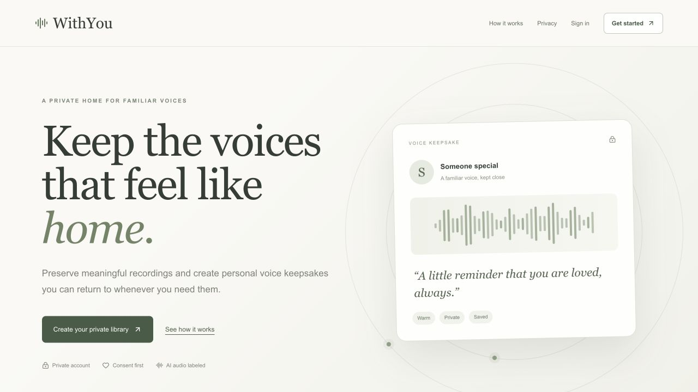

# WithYou

<p align="center">
  <a href="https://withyou.sanjana-nagwekar.workers.dev">
    
  </a>
</p>

<p align="center">
  <strong><a href="https://withyou.sanjana-nagwekar.workers.dev">Explore the live application →</a></strong>
</p>

WithYou is a private voice-keepsake application with a public product landing page and an authenticated personal studio. It preserves consented reference recordings, stores original memories, and creates clearly labeled synthetic keepsakes through a configurable speech provider. A keepsake can be replayed, downloaded, deleted, or regenerated in place with a different feeling, pace, and volume.

## Live application

**[Open WithYou](https://withyou.sanjana-nagwekar.workers.dev)**

The current portfolio MVP runs on Cloudflare Workers with D1 metadata, private R2 audio storage, Google and email/password authentication, and Cartesia voice generation. The public landing page is available without an account; recordings and generated keepsakes are restricted to the signed-in owner.

## Current capabilities

- Create a voice profile from an uploaded file or a guided browser recording with responsive local activity feedback, silence trimming, level normalization, and voice-ready PCM WAV output.
- Create an account with email and password, sign in with a secure session, and sign out.
- Use Google for first-time account creation and later sign-in, and safely link a verified Google identity to an existing verified account.
- Update a profile, change a password, revoke other sessions, and delete an account with all owned data.
- Enable email verification and password recovery through optional server-side email delivery.
- Organize each person as a voice profile with separate original-audio management, keepsake creation, and recent generated keepsakes.
- Generate a WAV keepsake through Cartesia or a deterministic local mock.
- Translate English keepsake text into a quality-gated set of 15 languages and synthesize it with a cached language-localized version of the selected voice.
- Change delivery settings without creating a second keepsake record.
- Remove an individual recording or permanently remove a voice profile with all associated recordings, keepsakes, stored audio, and provider clones.
- Enforce per-owner access, same-origin writes, daily generation limits, and per-voice generation locks.
- Reject files whose bytes do not match an allowed audio format, throttle recording uploads, and provide an operator generation kill switch.
- Store metadata in Cloudflare D1 and private audio objects in Cloudflare R2.
- Run private, provider-blinded A/B listening studies through tokenized reviewer links with randomized voice order and resumable responses.
- Test validation, provider behavior, API/data boundaries, and the primary browser journey.

## Product Decisions & Tradeoffs

WithYou is intentionally scoped as a private pilot rather than a complete social or commerce product. The MVP optimizes for three things in order: informed consent, recognizable voice quality, and a short path from recording to keepsake. Features that would increase reach or monetization were deferred when they also increased misuse risk, operational complexity, or uncertainty about the core experience.

### Privacy and consent before growth

Voice cloning can create real emotional value, but it can also be misused. The MVP therefore requires users to confirm permission before creating a voice profile, records the consent timestamp, isolates every library by owner, and supports deletion at the recording, keepsake, profile, and account levels. Deleting a profile also removes its stored audio and remote provider clones. Benchmark audio, participant identities, consent records, and provider voice IDs remain private and are excluded from Git; operational telemetry deliberately omits message text and raw provider errors.

This adds friction and postpones easy sharing, but that is an intentional tradeoff. A private, reversible workflow was a more responsible way to validate whether people value the product before introducing collaboration or public distribution.

### Choosing a voice provider with evidence

The current MVP uses Cartesia, based on an initial controlled comparison with ElevenLabs rather than a single demo clip. Four consenting speakers produced 24 paired cases using identical enrollment audio and prompts. The [preliminary automated results](benchmarks/results/english-v1-automated.md) showed:

| Product signal | Cartesia | ElevenLabs | Decision impact |
| --- | ---: | ---: | --- |
| Speaker similarity (median ECAPA cosine) | 0.821 | 0.783 | Cartesia better preserved the identity users came to hear. |
| Predicted naturalness (median UTMOS) | 3.150 | 3.214 | ElevenLabs sounded modestly more natural by this proxy, so there was no universal winner. |
| Word error rate (median) | 0.000 | 0.000 | Intelligibility did not separate the providers in the English test. |
| Generation latency (median) | 1,126 ms | 1,730 ms | Cartesia was faster in all 24 paired cases. |
| Failed generations | 0 of 24 | 0 of 24 | Reliability did not separate them in this small run. |

Cartesia was selected provisionally because speaker similarity is the product's quality gate, and its lower latency improves the creation loop. Its dedicated voice-localization path also supports a deliberately constrained multilingual experience. ElevenLabs' naturalness result remains important evidence, and the choice will be revisited after provider-blinded listener ratings and native-speaker multilingual testing.

Voice quality alone is not enough to make the product decision. A provider must first meet a minimum identity-similarity threshold; among providers that pass, the decision should also consider pronunciation, latency, failure rate, supported localization paths, and cost per successful generation. The current benchmark measures quality, latency, and reliability. Normalized provider cost and multilingual human ratings remain explicit gates before a commercial release. Until then, the language selector exposes only 15 languages with provider-supported localization rather than every language Google can translate.

### Deliberately excluded from the MVP

| Deferred feature | Why it was deferred |
| --- | --- |
| Payments and subscriptions | Validate repeated user value and understand generation costs before designing monetization. |
| Family sharing or public links | Sharing requires a stronger permissions, consent-withdrawal, and recipient-deletion model. |
| Every Google Translate language | Text translation support does not guarantee that the cloned voice will remain recognizable in that language. |
| Word-synchronized recording transcription | Early speech tracking lagged behind the speaker and created false precision; reliable audio capture and activity feedback mattered more. |
| Background generation queues | Synchronous generation, quotas, and per-voice locks are sufficient for pilot traffic; a queue becomes valuable when real usage shows contention or retry demand. |

### What I would improve with more user feedback

The next feedback loop would combine qualitative interviews with a small set of privacy-safe funnel measures: recording completion and re-record rate, time to first keepsake, generation success and latency, repeat creation, and deletion confidence. I would use that evidence to improve recording guidance and onboarding first, complete the blinded and multilingual listening study, and then decide whether collaboration, asynchronous processing, or payments solves the most important observed user problem. This keeps the roadmap tied to user behavior instead of adding features only because the underlying technology makes them possible.

## Local setup

Prerequisites: an even-numbered Node.js release supported by the toolchain (22.13+, 24, or 26+) and npm. Continuous integration uses Node.js 24.

```bash
npm ci
cp .env.example .env
npm run build
npx wrangler d1 execute DB --local --config dist/server/wrangler.json --persist-to .wrangler/state --file drizzle/0000_new_makkari.sql
npx wrangler d1 execute DB --local --config dist/server/wrangler.json --persist-to .wrangler/state --file drizzle/0001_bizarre_cardiac.sql
npx wrangler d1 execute DB --local --config dist/server/wrangler.json --persist-to .wrangler/state --file drizzle/0002_dark_thunderball.sql
npx wrangler d1 execute DB --local --config dist/server/wrangler.json --persist-to .wrangler/state --file drizzle/0003_auth_rate_limits.sql
npx wrangler d1 execute DB --local --config dist/server/wrangler.json --persist-to .wrangler/state --file drizzle/0004_low_molly_hayes.sql
npx wrangler d1 execute DB --local --config dist/server/wrangler.json --persist-to .wrangler/state --file drizzle/0005_public_pilot_limits.sql
npx wrangler d1 execute DB --local --config dist/server/wrangler.json --persist-to .wrangler/state --file drizzle/0006_benchmark_foundation.sql
npx wrangler d1 execute DB --local --config dist/server/wrangler.json --persist-to .wrangler/state --file drizzle/0007_pairwise_review.sql
npm run dev
```

## Production deployment

The production application is available at `https://withyou.sanjana-nagwekar.workers.dev`. Cloudflare resource identifiers live in `deployment.json`. Build and deploy with:

```bash
npm run deploy:production
```

Production credentials must be stored as encrypted Worker secrets. They are declared as required in
the generated Wrangler configuration and must never be committed as plain-text variables.

Open `http://localhost:5173`, create an account, and sign in. Development uses an explicitly local-only session secret when `BETTER_AUTH_SECRET` is empty; production refuses to start without a configured secret and base URL. The first local account automatically takes ownership of data created by the earlier local prototype so existing recordings are not lost.

To enable live voice generation, add `CARTESIA_API_KEY` to `.env`. The browser never receives this secret. Without it, original recordings can still be uploaded, played, downloaded, and deleted.

To enable multilingual keepsakes, add the complete Google Cloud Translation service-account JSON as `GOOGLE_TRANSLATE_SERVICE_ACCOUNT_JSON`. Translation runs only on the server. The production setup and quality constraints are documented in [Multilingual keepsakes](docs/MULTILINGUAL.md).

## Safe demo data

The deterministic mock provider is limited to environments that explicitly opt in. Start a local server with both controls enabled, then seed it:

```bash
WITHYOU_VOICE_PROVIDER=mock WITHYOU_ALLOW_MOCK_PROVIDER=true WITHYOU_TRANSLATION_PROVIDER=mock WITHYOU_ALLOW_MOCK_TRANSLATION=true npm run dev
npm run seed
```

The seed command is idempotent and refuses to run against Cartesia. Do not enable the mock provider in production.

## Environment variables

| Variable | Required | Purpose |
| --- | --- | --- |
| `CARTESIA_API_KEY` | For live generation | Server-side Cartesia credential. |
| `CARTESIA_MODEL_ID` | No | Cartesia model; defaults to `sonic-3.6`. |
| `WITHYOU_VOICE_PROVIDER` | No | `cartesia` by default; `mock` for controlled demos/tests. |
| `WITHYOU_ALLOW_MOCK_PROVIDER` | For mock mode | Must be `true` before mock generation is allowed. |
| `WITHYOU_GENERATION_ENABLED` | No | Emergency server-side generation kill switch; defaults to `true`. |
| `WITHYOU_DAILY_GENERATION_LIMIT` | No | Rolling 24-hour successful-generation limit per account; defaults to `30`. |
| `WITHYOU_GLOBAL_DAILY_GENERATION_LIMIT` | No | Rolling 24-hour successful-generation limit across the deployment; defaults to `300`. |
| `GOOGLE_TRANSLATE_SERVICE_ACCOUNT_JSON` | For live translation | Complete server-side Google Cloud service-account credential JSON for Translation Advanced v3. |
| `WITHYOU_TRANSLATION_PROVIDER` | No | `google` by default; `mock` for controlled demos/tests. |
| `WITHYOU_ALLOW_MOCK_TRANSLATION` | For mock translation | Must be `true` before deterministic mock translations are allowed. |
| `BETTER_AUTH_SECRET` | Production | High-entropy secret of at least 32 characters used to protect sessions. |
| `BETTER_AUTH_URL` | Production | Public application origin, such as `https://withyou.example`. |
| `GOOGLE_CLIENT_ID` | For Google sign-in | Google OAuth web client ID. Must be set with its client secret. |
| `GOOGLE_CLIENT_SECRET` | For Google sign-in | Google OAuth web client secret. Must be set with its client ID. |
| `RESEND_API_KEY` | For verification/recovery email | Server-side Resend credential. Must be set with the sender address. |
| `AUTH_EMAIL_FROM` | For verification/recovery email | Verified sender email address used for account messages. |
| `WITHYOU_ALLOW_UNVERIFIED_EMAIL_SIGNUP` | Local tests only | Explicitly enables password signup without email delivery. Never enable this in a public deployment. |
| `WITHYOU_BASE_URL` | Seed only | Seed target; defaults to `http://localhost:5173`. |
| `WITHYOU_PERSIST_PATH` | Test tooling only | Overrides local Cloudflare state location. |

Provider configuration is validated before the authenticated application renders. Invalid modes and unsafe mock configuration fail immediately. A missing Cartesia credential disables generation with an explicit server-side response while leaving original-recording features available.

## Verification

```bash
npm run lint
npm run typecheck
npm run test:coverage
npm run test:integration
npm run test:e2e
npm run build
```

`npm run validate` runs every non-browser check. Integration tests create isolated temporary D1 and R2 resources. End-to-end tests rebuild the application, reset a dedicated local state directory, start the mock provider, and run Chromium through the main user journey.

## Production requirements

Production uses D1-backed accounts, encrypted OAuth tokens, hashed verification identifiers, database-backed authentication and upload rate limits, byte-signature audio validation, rolling generation caps, and secure HTTP-only session cookies. Set `BETTER_AUTH_SECRET` and `BETTER_AUTH_URL` before deployment. To enable Google sign-in, create a separate production Google OAuth web client and register `https://YOUR_DOMAIN/api/auth/callback/google` as an authorized redirect URI, then configure both Google variables. New password registration stays disabled in production until verification email delivery is configured; existing password accounts can still sign in. See [Authentication](docs/AUTHENTICATION.md) for the complete Google account lifecycle, console checklist, and release test.

The current pilot has no payment processing, family sharing, subscription logic, background job queue, antivirus engine, or legal-authority verification. It accepts audio whose declared type and file signature identify MP3, WAV, M4A, OGG, AAC, or WebM content up to 15 MB. Generations are limited to 1,000 characters, 30 successful generations per user per rolling day, and 300 successful generations globally per rolling day by default.

See [Architecture](docs/ARCHITECTURE.md), [Voice-model benchmarking](docs/BENCHMARKING.md), [Authentication](docs/AUTHENTICATION.md), [Testing](docs/TESTING.md), [Privacy](app/privacy/page.tsx), [Terms](app/terms/page.tsx), [Contributing](CONTRIBUTING.md), and [Security](SECURITY.md) for more detail.
